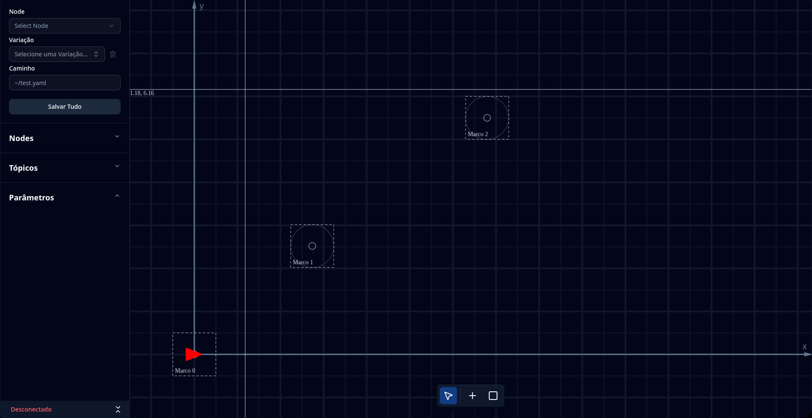

# Perse UI

## 🌍 Visão Geral

Perse UI é uma interface de usuário web para interagir com o [Perse](https://github.com/ThundeRatz/perse), fornecendo uma maneira intuitiva de visualizar e manipular dados em um ambiente ROS2.

A interface permite o controle e visualização de waypoints, parâmetros de configuração e outros dados relevantes para o Perse.

## 🏛️ Arquitetura

O projeto é um pacote ROS2 que consiste em duas partes principais:

1.  **Nó ROS2 (`perse_ui`):** Um nó Python que atua como uma ponte entre o ecossistema ROS2 e a interface do usuário. Ele se comunica com outros nós ROS através de tópicos, serviços e ações, e expõe esses dados para a interface web via websockets.

2.  **Interface de Usuário (UI):** Uma aplicação web de página única (SPA) desenvolvida com React, Vite e TypeScript, localizada na pasta `ui/`. A interface se conecta ao nó ROS2 para enviar comandos e receber atualizações em tempo real.



## ✨ Funcionalidades

*   🗺️ **Visualização de Waypoints:** Visualize os waypoints em um mapa 2D interativo.
*   ✍️ **Manipulação de Waypoints:** Adicione, remova e edite waypoints diretamente na interface.
*   ⚙️ **Configuração de Parâmetros:** Modifique os parâmetros do sistema em tempo real.
*   🔄 **Seleção de Variações:** Troque entre diferentes configurações e variações do sistema.
*   🤖 **Visualização do Robô:** Veja a posição e orientação do robô no mapa.

## 📋 Pré-requisitos

- ROS2 (distribuição recomendada: Humble Hawksbill)
- Node.js (versão 18 ou superior)
- `colcon` (ferramenta de build do ROS2)

## 🚀 Instalação e Execução

1.  **Clone o repositório:**
    ```bash
    git clone <URL_DO_REPOSITORIO>
    cd perse_ui
    ```

2.  **Instale as dependências da UI:**
    ```bash
    cd ui
    npm install
    cd ..
    ```

3.  **Compile o pacote ROS2:**
    ```bash
    colcon build --packages-select perse_ui
    ```

4.  **Execute o launch file:**
    ```bash
    source install/setup.bash
    ros2 launch perse_ui perse_ui.launch.py
    ```

5.  **Acesse a interface:**
    Abra seu navegador e acesse `http://localhost:8000`.

## 🛠️ Construído Com

*   **ROS2:** Framework para robótica
*   **React:** Biblioteca para construção de interfaces de usuário
*   **Vite:** Ferramenta de build para o frontend
*   **TypeScript:** Superset de JavaScript que adiciona tipagem estática
*   **Tailwind CSS:** Framework de CSS para estilização
*   **Fabric.js:** Biblioteca para manipulação de canvas
*   **shadcn/ui:** Componentes de UI para React
