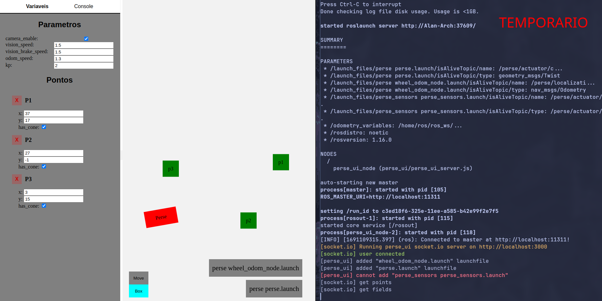

# Perse UI



Uma interface para alterar as constantes e as posições dos cones do Perse

## Pré-requisitos

- NodeJS
- ROS1 (noetic ou kinetic)

## Instalação


basta clonar o repositório dentro de uma workspace ros, instalar as dependências do nodejs e compilar.

```bash
git clone REPOSITORIO
cd perse_ui
npm install
catkin build perse_ui
```

## Como Rodar

Rodar o projeto consiste em duas etapas: iniciar o servidor web e iniciar o servidor ros

### Servidor web

```bash
npm run dev
```
### Servidor ros

```bash
roslaunch perse_ui perse_ui.launch
```


## Configuração

A ideia é esse projeto não depender completamente da arquitetura do Perse, para isso dentro do arquivo de configuração `config.yaml` estão listados os launchfiles que compõem o perse e um tópico usado para saber se o launchfile está rodando no momento.

```yaml
# config.yaml

launch_files:
  perse perse.launch:
    isAliveTopic: 
      name: /perse/actuator/cmd_vel
      type: geometry_msgs/Twist
  perse_sensors perse_sensors.launch:
    isAliveTopic:
      name: /perse/actuator/cmd_vel
      type: /perse/actuator/cmd_vel
```


# O que falta ser feito

- Melhorar o visual
- Adicionar a função de desenhar características da pista que não afetam o código
- Criar um arquivo que guarda informações da interface
- Enviar comandos para os terminais a partir da interface (atualmente ela só recebe a saida do terminal)
- Enviar a posição atual do Perse (odometria) para a interface
- Criar uma forma de visualizar tópicos ROS na interface
- Repensar a estrutura do código
